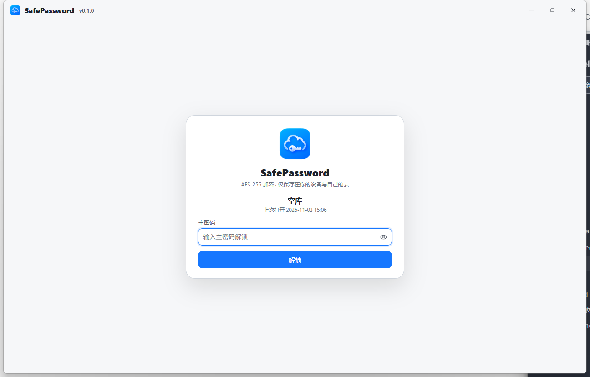
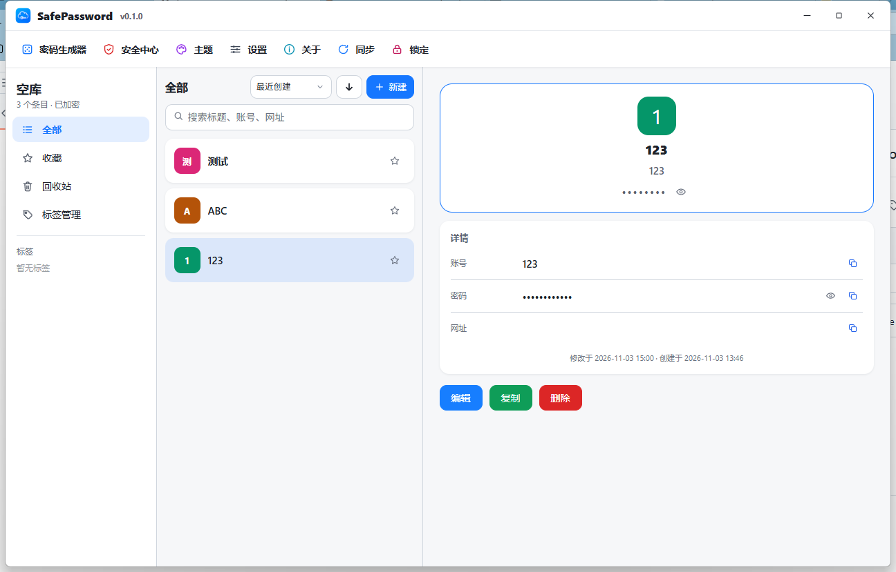
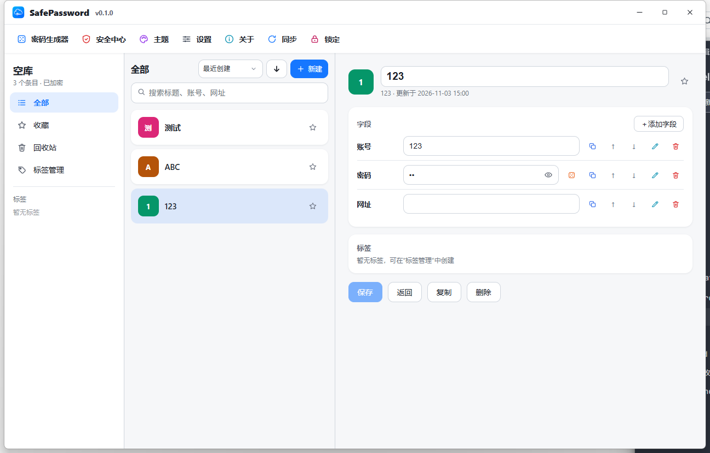
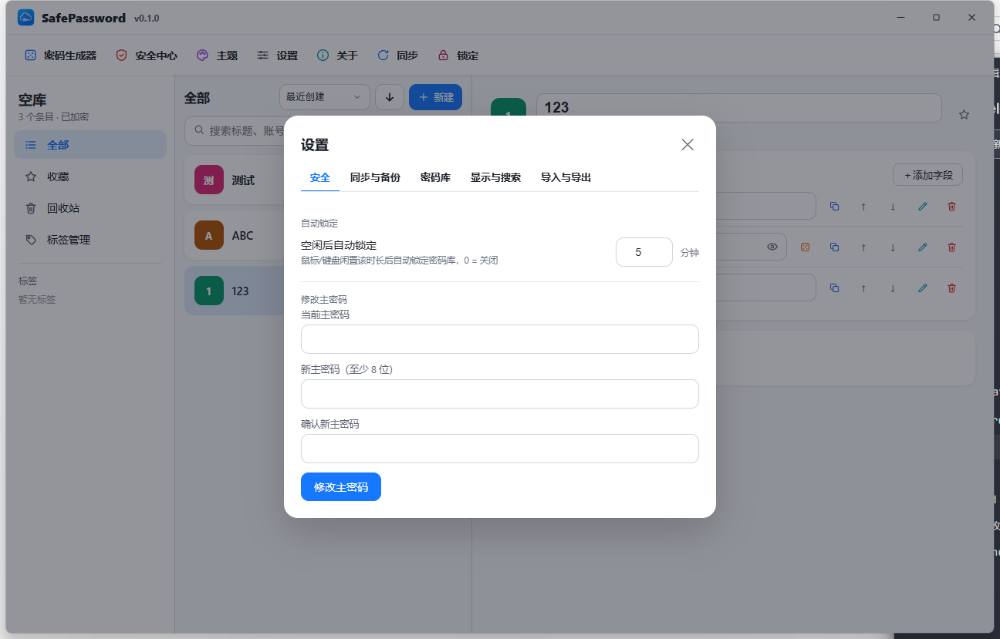
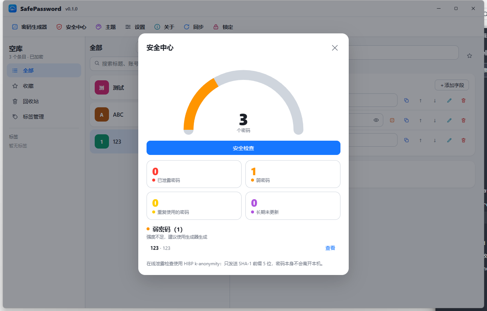
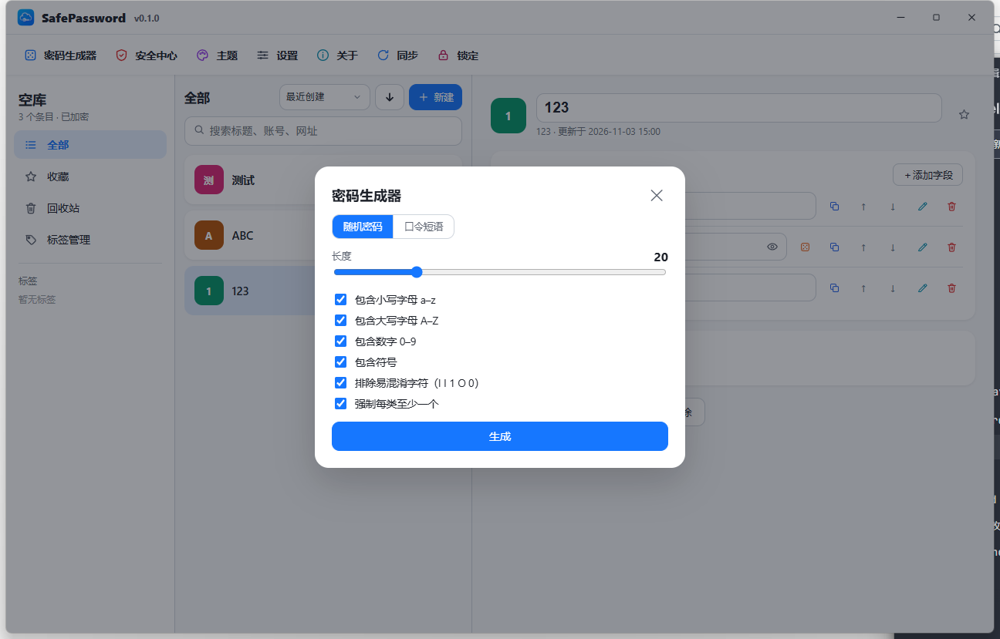

# SafePassword Desktop

SafePassword 桌面版是一个离线优先的密码管理器。界面与数据模型对齐 Android 版，使用 **Tauri 2 + Rust + React** 实现，密码库文件与手机端**逐字节兼容**，可通过同一 WebDAV 目录在手机与电脑之间同步。数据默认只保存在本机，通过主密码派生密钥后加密存储。

- 项目名：`SafePassword Desktop`
- 应用标识：`com.yaoahos.safepassword.desktop`
- 正式版本：`1.0.3`
- 支持平台：Windows 10 / 11（x64，需要 WebView2 运行时）
- 安装包：`SafePassword_1.0.3_x64-setup.exe`（NSIS）/ `SafePassword_1.0.3_x64_zh-CN.msi`
- 安装包大小：2,400,800 字节（NSIS）/ 3,383,296 字节（MSI）
- SHA-256：`8054D933AAACA539941448B27F73A1E37FB9864017891382C63BDB91BF3D3CE6`（NSIS）/ `B93BBC2B9CEE46946B6EC879FA46022BE6D3D013674240ACAC7666560AF0A4C9`（MSI）
- 发布下载：[Releases](https://github.com/yaoahos/SafePasswordDesktop/releases)

> 本项目为独立实现，未使用任何第三方应用的源代码；界面与交互仅作设计参考。密码库格式与 Android 版互通。

---

## 界面预览

| 解锁 | 主界面 | 条目详情 |
| :---: | :---: | :---: |
|  |  |  |

| 设置 | 安全中心 | 密码生成器 |
| :---: | :---: | :---: |
|  |  |  |

---

## 一、软件介绍

SafePassword Desktop 面向希望把密码数据掌握在自己手里的用户。它不依赖厂商云、不要求注册账号，也不包含浏览器扩展、自动填充或统计 SDK。密码库文件在离开电脑前已经完成加密，WebDAV 只负责传输密文。

设计目标：

1. **本地优先**：没有网络也能完整使用。
2. **可迁移**：密码库、备份和导出文件可以自由复制，手机与电脑互开。
3. **可审计**：加密、容器格式、同步与合并逻辑集中在独立的 Rust 模块 `src-tauri/src/sp/`，有单元测试与跨端互操作测试。
4. **克制**：只有用户主动配置 WebDAV 或启用泄露查询时才联网，不接入统计与广告。
5. **桌面体验**：自定义标题栏、三栏布局、快捷键与系统原生文件对话框。

---

## 二、功能一览

**密码库**
- 创建多个密码库，每个使用独立主密码；支持主密码解锁、自动锁定（闲置 N 分钟）。
- 重命名、切换、删除；本地加密备份与恢复；新设备可从本地或云端恢复。
- 删除或重命名密码库会同步到云端，避免出现"本地一份、云端另一份"。

**条目**
- 新建、编辑、预览、复制、删除；回收站支持软删除、恢复与永久删除。
- 字段类型：文本、密码、秘密、多行文本、网址、邮箱、电话；支持增删、改名、上下移动。
- 密码独立显示/隐藏并附强度提示；可收藏（点击星标立即生效）、多标签；默认图标取标题首字符并配随机主题色，也可上传自定义图片图标。
- 备注可编辑、改名、调整位置；新建条目不默认占用备注区。

**搜索与排序**
- 常驻搜索框，可搜标题、账号、网址，可选是否搜索密码内容。
- 排序支持最近创建、最近更新、标题，支持升/降序切换。

**同步与安全**
- 任意标准 WebDAV 同步：保存并立即同步、拉取云端覆盖本地、自动同步（改动后 1.5 秒防抖）、自动拉取（关闭 / 30 秒 / 1 分钟 / 5 分钟）。
- 云端按密码库分文件保存（`SafePassword-<key>.spv` + 清单文件），改名不会在云端多出副本；解锁后自动同步一次。
- 同步发现云端已删除当前库时弹窗提示「删除本地 / 恢复到云端」，可选「稍后处理」（之后只在手动同步时再提示）。
- 安全中心：半圆仪表 + 已泄露 / 弱密码 / 重复使用 / 长期未更新四类统计，支持 HIBP k-匿名查询。
- 密码生成器：随机密码与口令短语，可指定字符集、排除易混淆字符。
- 复制敏感内容 30 秒后自动清空剪贴板（与手机端一致，仅当内容未变时清空）。

**导入导出与外观**
- 导入 CSV、XML、明文 JSON；导出 CSV / XML / JSON。
- 导出加密备份 `.spv`（可直接拷回手机），默认走系统保存对话框。
- 20 种预置主题色与自定义颜色；浅色 / 深色 / 跟随系统。
- 标签管理：五边形标签图标、20 种预置色与自定义色值、排序值、批量删除。

**更新**
- 关于页「检查更新」从 GitHub Releases 拉取最新版本；有新版本时可下载并启动安装包。

---

## 三、技术选型

| 层次 | 选型 | 说明 |
| --- | --- | --- |
| 外壳 | Tauri 2 | 原生窗口 + WebView2，安装包约 2 MB |
| 后端 | Rust 1.99 | 加密、容器、存储、同步、命令层 |
| 前端 | React 19 + TypeScript 5.8 | 三栏界面、对话框、状态管理 |
| 构建 | Vite 6 + tsc | 严格模式类型检查 |
| 加密 | `aes-gcm` 0.10 + `pbkdf2` 0.12 + `sha2` 0.10 | AES-256-GCM、PBKDF2-HMAC-SHA256 |
| 网络 | `reqwest` 0.12 | WebDAV 与 HIBP 请求 |
| 序列化 | `serde` / `serde_json` | 密码库 JSON 与配置 |
| XML | `quick-xml` 0.37 | 通用 XML 导入导出 |
| 本地配置加密 | Windows DPAPI | settings.json 中的敏感字段 |
| 系统集成 | `tauri-plugin-opener` / `tauri-plugin-dialog` | 打开网址、系统保存对话框 |

---

## 四、安全设计

### 1. 密码库加密

- 主密码通过 **PBKDF2-HMAC-SHA256** 派生密钥，迭代次数 **210,000**（与手机端一致）。
- 使用 **AES-256-GCM** 加密密码库内容，每次随机 12 字节 IV，认证标签 128 位。
- 密码库内容由数据密钥（DEK）加密，DEK 再由主密码派生的密钥包裹（AAD 固定串），更换主密码只需重新包裹 DEK。
- 文件格式：3 字节魔数（SPV）+ 版本 + 迭代次数 + salt + 包裹后的 DEK + 密文，全部大端；与 Android 版**逐字节互通**。
- 主密码不写入磁盘、不上传服务器；密码库文件与备份在离开设备前均为密文。

### 2. 本地配置

- `settings.json` 中的 WebDAV 密码与 HIBP API Key 使用 **Windows DPAPI**（当前用户 + 固定熵）加密后存储，前缀 `dpapi:`。
- 内存中保持明文以便使用；旧版本遗留的明文配置会在下次保存时自动转为密文。
- 换机器或重装系统后 DPAPI 密文无法解密，应用会回退为空值，需要重新填写。

### 3. 网络与隐私

- 仅在用户配置 WebDAV 或启用泄露查询时访问网络。
- 不包含统计、广告、崩溃上报 SDK。
- HIBP 使用 SHA-1 前缀查询（只发前 5 位），服务端无法直接得到完整密码。
- WebDAV 传输的是密文文件；服务商只能看到密文与文件大小。
- 页面启用严格 CSP：禁止内联脚本、限制 `connect-src` 为 IPC 与本地资源。
- 全局禁用右键菜单（输入框除外），避免出现浏览器式"刷新/打印"等菜单。
- 外部链接通过 `tauri-plugin-opener` 打开，能力范围限定为 http/https/mailto/tel。

### 4. 桌面侧防护

- 主密码只在解锁期间驻留内存，锁定即丢弃。
- 复制密码 30 秒后自动清空剪贴板（内容未变时才清）。
- 自动锁定按闲置时间触发，可设为 0 关闭。

> 安全边界：主密码遗忘后无法恢复；请同时保留加密备份。任何密码管理器都不能防御已被植入木马或实时录屏的设备。

---

## 五、项目构建

### 1. 环境要求

- Rust stable（MSVC 工具链）+ Visual Studio Build Tools（C++ 生成工具）+ Windows SDK。
- Node.js 18+ 与 npm。
- Windows 10/11 自带 WebView2 或已安装 WebView2 运行时。

### 2. 安装依赖

```bat
npm install
```

### 3. 开发调试

```bat
npm run tauri dev
```

### 4. 正式构建

```bat
:: 先构建前端（tsc + vite）
npm run build
:: 再打包（NSIS + MSI）
npx tauri build
```

产物：

```text
src-tauri/target/release/bundle/nsis/SafePassword_1.0.3_x64-setup.exe
src-tauri/target/release/bundle/msi/SafePassword_1.0.3_x64_zh-CN.msi
```

首次打包若卡在 NSIS 工具下载，可先设置本机代理再重试（地址与端口按自己的代理软件改）：

```bat
set HTTP_PROXY=http://127.0.0.1:7890
set HTTPS_PROXY=http://127.0.0.1:7890
```

### 5. 测试

```bat
cargo test --manifest-path src-tauri/Cargo.toml
```

- 当前 93 个测试通过（88 个单元测试 + 3 个命令层 E2E + 1 个 WebDAV 双设备同步 E2E + 1 个 mock 冒烟），另有 1 个实网 HIBP 测试默认跳过（`cargo test -- --ignored`）。
- 跨端字节兼容：`interop/` 下用手机端 Kotlin core 生成夹具，验证 Rust 能解、手机端能解 Rust 写出的 `.spv`，明文 JSON 逐字节一致。

---

## 六、使用说明

**首次启动**：没有任何密码库时，欢迎页提供「创建密码库 / 从本地恢复 / 从云端恢复」；已有密码库时只显示解锁入口。

**恢复数据**

- 从本地恢复：选 `.spv` 文件→ 输入该文件主密码 → 可改名 → 进入密码库。
- 从云端恢复：直接填写 WebDAV 地址、用户名、密码、远程目录 → 读取云端清单 → 选中一个库 → 输入该库主密码 → 下载并导入。

**日常使用**

- 解锁：主密码；闲置超过设定分钟数会自动锁定。
- 条目：中间栏选中即预览；点「编辑」进入编辑态，字段可增删改与排序；「复制」生成副本；「删除」进回收站并需确认。
- 标签：左栏「标签管理」，可创建、配色、排序、批量删除。
- 同步：顶栏「同步」按本地优先直接同步；设置 → 同步与备份可配置 WebDAV、自动同步、自动拉取间隔与本地备份。
- 备份：设置 → 同步与备份 → 立即创建备份；备份文件默认写到安装目录下的 `data\backups` 文件夹，恢复时选择文件并输入该备份主密码。
- 导入导出：设置 → 导入与导出；导入支持多选 CSV / XML / JSON，导出可选 CSV / XML / JSON 或加密备份 `.spv`（系统保存对话框，默认按「库名-日期-时间」命名）。
- 主题：顶栏「主题」，20 种预置色 + 自定义 `#RRGGBB`。
- 更新：关于页「检查更新」。

**数据位置**：`<安装目录>\data\`（便携语义，跟着安装目录走；装到 `Program Files` 这类不可写位置时自动回落到 `%APPDATA%\com.yaoahos.safepassword.desktop`）。首次从旧版本升级时会把旧目录整体搬过来，搬完删除旧目录。

```text
data/
├── vaults/              密码库文件（{id}.spv）与索引
├── backups/             自动/手动备份
├── window.json          上次窗口位置与尺寸
└── settings.json        设置（敏感字段为 DPAPI 密文）
```

> 卸载会连同 `data/` 一起删除，卸载前请先在「设置 → 导入与导出」里导出备份。

---

## 七、项目结构

```text
SafePasswordDesktop/
├── src/                        React 前端
│   ├── App.tsx                 主逻辑：解锁、同步、条目操作、对话框路由
│   ├── api.ts                  与 Rust 命令层的 invoke 封装
│   ├── types.ts                前后端共享类型
│   ├── utils.ts                图标、格式化、复制等工具
│   ├── app-context.ts          跨组件上下文类型
│   ├── components/             顶栏、标题栏、侧边栏、列表、详情、弹窗外壳、图标
│   └── dialogs/                设置、生成器、安全中心、主题、标签、关于、锁定等
├── src-tauri/                 Rust 后端（Tauri 2）
│   ├── src/commands.rs         命令层（40+ 命令）
│   ├── src/main.rs             应用入口、插件与命令注册
│   ├── src/sp/                 与手机端字节兼容的核心移植
│   │   ├── crypto.rs           PBKDF2 + AES-GCM + 密钥包裹
│   │   ├── container.rs        .spv/.spv 容器读写
│   │   ├── model.rs            密码库数据模型
│   │   ├── store.rs            密码库文件与索引
│   │   ├── xml.rs              通用 XML 导入导出
│   │   ├── codec.rs            CSV / JSON 导入导出
│   │   ├── webdav.rs / sync.rs WebDAV 客户端与同步引擎
│   │   ├── cloud.rs            云端多库清单
│   │   ├── merger.rs           冲突合并
│   │   ├── backup.rs           本地备份
│   │   ├── generator.rs / strength.rs / security.rs / hibp.rs
│   │   └── dpapi.rs            Windows DPAPI 配置加密
│   ├── tests/                  命令层 E2E、WebDAV 双设备 E2E
│   ├── capabilities/           Tauri 权限（窗口、opener、dialog）
│   └── tauri.conf.json         窗口、CSP、打包配置
├── interop/                    与 Android core 的互操作夹具工程（Kotlin + Gradle）
├── docs/                       格式说明与 README 截图
└── README.md
```

---

## 八、兼容性与限制

- 仅提供 Windows x64 安装包（Tauri 可交叉构建到 Linux/macOS，但当前未提供）。
- 只支持 WebDAV 同步，不接入专有云 API。
- 不包含浏览器扩展、自动填充、Passkey、TOTP、共享协作与附件管理。
- 主密码遗忘后无法恢复；请务必保留加密备份。
- 从手机端导入的条目若含附件引用，附件不会随文件带过来（本版本不支持附件）。
- 云端冲突默认本地优先；需要以云端为准时使用「拉取云端数据（覆盖本地）」。

---

## 九、开源组件与致谢

- [Tauri](https://tauri.app/) — Apache-2.0 / MIT
- [Rust](https://www.rust-lang.org/) — Apache-2.0 / MIT
- [React](https://react.dev/) — MIT
- [Vite](https://vite.dev/) — MIT
- [RustCrypto AEADs](https://github.com/RustCrypto/AEADs) — Apache-2.0 / MIT
- [quick-xml](https://github.com/tafia/quick-xml) — MIT
- [reqwest](https://github.com/seanmonstar/reqwest) — Apache-2.0 / MIT
- [serde](https://serde.rs/) — Apache-2.0 / MIT
- [Have I Been Pwned](https://haveibeenpwned.com/) — 泄露查询 API

界面设计参考公开截图，代码、数据结构和实现均为独立完成。

---

## 十、版本记录

**2026/11/05 · 1.0.3**
- 修复：设置中指定的「默认展示」标签在解锁后未生效，进入首页仍显示全部条目
- 优化：条目默认图标配色由 8 种增加到 17 种，并让取色分布更均匀，减少多个条目颜色相近的情况

**2026/11/05 · 1.0.2**
- 优化：完善检查更新失败的提示，触发频率限制时给出可重试的时间
- 修复：更新检查不再显示 HTTP 状态码与接口返回内容，下载失败仅提示处理方式
- 优化：调整解锁页的间距、圆角与输入框高度，改善版面留白

**2026/11/04 · 1.0.1**
- 修复：从云端恢复后首次同步会误报“已上传本地更新”，本地与云端内容相同时也重复上传
- 修复：新建密码库同步时可能覆盖云端清单里的其它库
- 修复：CSV / XML 导出再导入会丢失标签颜色、标签排序与秘密字段类型
- 新增：本地库名与云端已有库重名时提示改名，改完自动继续同步
- 新增：设置里可关闭「启动时检查更新」
- 优化：从云端恢复页的配置不再填完地址和用户名就自动收起，按钮改为展开 / 收起
- 优化：删除云端密码库改为按 key 精确清理，不再误删同名库；上传提示统一文案

**2026/11/03 · 1.0.0**
- 密码库管理：创建、从本地备份或 WebDAV 云端恢复、解锁与自动锁定；库文件与 Android 版逐字节兼容，可直接互相打开
- 条目管理：条目与自定义字段的增删改、字段排序、标签、收藏、回收站，以及标题 / 账号 / 网址搜索与多种排序
- 多端同步：同一 WebDAV 目录下多库同步、云端清单、解锁即同步、自动与手动同步、双向合并、云端删除提示、改名后仍同步同一文件
- 备份与迁移：本地备份、导出加密备份文件（`.spv`）、CSV / XML / JSON 导入导出，导出走系统保存对话框
- 密码工具：密码生成器（随机密码与口令短语）、安全中心（强度、重复使用、长期未更新、HIBP 泄露查询）
- 安全机制：主密码经 PBKDF2-HMAC-SHA256（210,000 次）派生密钥、AES-256-GCM 加密，库内容先压缩再加密；设置中的敏感字段用 Windows DPAPI 保护
- 外观与交互：20 种主题色与自定义配色、浅色 / 深色 / 跟随系统、自定义标题栏、三栏自适应布局、条目预览卡片
- 其他：检查更新与就地升级、复制敏感内容 30 秒自动清空、空闲自动锁定
